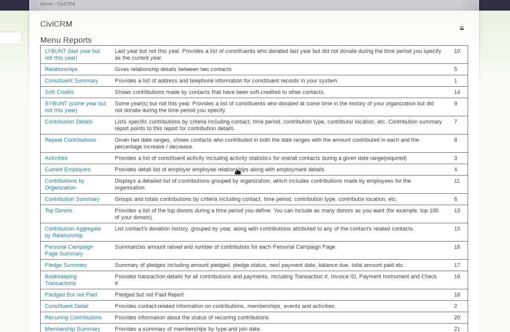

# com.ixiam.modules.menureport

This extension allows users to manage and sort the list of custom reports in CiviCRM through a drag-and-drop interface.

## Usage

1. Navigate to: `civicrm/a/#/menureport`
2. Search for the reports you want to reorder using the filter input.
3. Drag and drop rows to set your preferred order (sorting is disabled while filtered to ensure consistency).
4. The new order is saved instantly as soon as you stop dragging.
